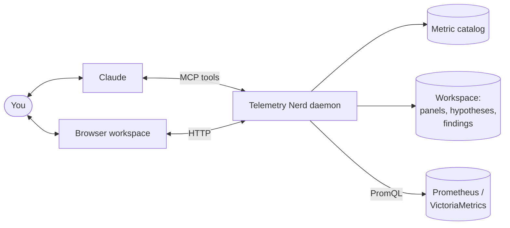

# Telemetry Nerd

### a power tool for power telemetry users

<div class="pt-12 opacity-80">
Avishai Ish-Shalom · DevOpsDays Tel Aviv 2026
</div>

<div class="abs-br m-6 text-sm opacity-60">
github.com/Fewbytes/telemetry-nerd
</div>

<!--
Hi. Quick show of hands: who's been paged, opened a dashboard, and the dashboard said everything is fine?
-->

---
layout: center
class: text-center
---

# Your dashboards are lying to you

<v-click>

### …and nothing on screen says so.

</v-click>

<!--
Not maliciously. Every one of these lies is a sensible default somebody picked to make a pretty chart.
-->

---

# Lie #1: averaged rollups erase the spike

<div class="grid grid-cols-2 gap-8 pt-4">
<div>

- 15s scrape, 7-day view, ~1000 pixels wide
- Every pixel is ~10 minutes ≈ 40 samples
- Default downsampling: **mean**
- A 30s saturation spike becomes a 5% bump

</div>
<div>

<!-- TODO: chart — raw vs mean-rollup vs min/max envelope -->
<div class="border-2 border-dashed rounded p-8 opacity-50 text-center">
raw · mean rollup · min/max envelope
</div>

</div>
</div>

<v-click>

> The spike you're hunting is exactly what the rollup throws away.

</v-click>

<!--
TODO: real chart from the demo data.
-->

---

# Lie #2: gaps get bridged with straight lines

<div class="grid grid-cols-2 gap-8 pt-4">
<div>

- Exporter dies at 14:02, comes back at 14:40
- Chart draws a nice straight line between them
- A dead exporter looks like **a calm system**

</div>
<div>

<!-- TODO: chart — interpolated gap vs gap shown and named -->
<div class="border-2 border-dashed rounded p-8 opacity-50 text-center">
interpolated · gap shown and named
</div>

</div>
</div>

<v-click>

> Missing data is information. Silence is a signal, not a smoothing opportunity.

</v-click>

---

# Lie #3: autoscaled axes

<div class="grid grid-cols-2 gap-8 pt-4">
<div>

- y-axis from min to max of the visible data
- A 3% wiggle fills the whole panel
- Looks exactly like an outage

</div>
<div>

<!-- TODO: chart — autoscaled vs contextual y-range -->
<div class="border-2 border-dashed rounded p-8 opacity-50 text-center">
autoscaled · against its bounds
</div>

</div>
</div>

<v-click>

> Ratios belong on 0 to 1. Usage belongs against its limit.

</v-click>

---

# Lie #4: the "p99" panel

```sql
avg by (service) (
  histogram_quantile(0.99, rate(http_request_duration_seconds_bucket[5m]))
)
```

<v-clicks>

- That's the **mean of per-host p99s**
- It is nobody's p99
- Can be off by **nearly 70%**
- Percentiles don't average. Histograms merge; quantiles don't.

</v-clicks>

<!--
TODO: show the actual number from the demo — per-host p99s, their mean, the merged-histogram p99.
-->

---
layout: center
---

# Now hand those charts to an AI agent

<v-clicks>

- It inherits **every** mistake
- …and reports them **with total confidence**
- "Root cause: payment service latency spike." (It was a scrape gap.)

</v-clicks>

---

# Investigation ≠ dashboards

| Dashboards | Investigation |
|---|---|
| Known questions | New question every few minutes |
| Glanceable, pretty | Correct, explicit about what it doesn't know |
| One chart, many viewers | Many charts, one chain of reasoning |
| "Is it red?" | "Why, where, since when, compared to what?" |

<v-click>

> Different job, different tools.

</v-click>

---

# Telemetry Nerd

An open-source **investigation workspace** where you and Claude work through your
Prometheus-compatible metrics together.

<v-clicks>

- Ask in plain language
- Claude queries, graphs, records **hypotheses** and **findings**
- Shared browser workspace: you see what Claude sees, Claude sees what you pin
- Prometheus, VictoriaMetrics, Grafana-fronted sources, Elasticsearch / OpenSearch

</v-clicks>

---

# How it fits together



<v-click>

Bulk data never enters Claude's context. Claude gets statistics, the browser gets the series.

</v-click>

---

# It knows what your metrics mean

An **autolearned catalog**: per metric, its type, unit, bounds, additivity and role.

<div class="grid grid-cols-2 gap-8 pt-2">
<div>

Built from:

- source metadata (TYPE / HELP / UNIT)
- exporter knowledge packs
- your repo's code and dashboards
- **you** (and you outrank everything)

</div>
<div>

So that:

- counters become rates
- ratios sit on 0 to 1
- usage is drawn against its limits
- every fact carries **origin and confidence**

</div>
</div>

---

# Correct by design

<v-clicks>

- Percentiles **only from merged histograms**
- **min/max envelopes** on every rollup
- Missing data **shown and named**, never filled
- Every number carries its **uncertainty** (or says "uncertainty unknown")
- No dual y-axes, no stacking non-additive series, no spaghetti

</v-clicks>

---

# Enforced in code, not by asking the LLM nicely

```python {all|3|4|2-4}
class FindingIn(_Strict):
    claim: str = Field(min_length=1)
    scope: Scope                                   # source, selector, range, step, aggregation
    evidence: list[EvidenceRef] = Field(min_length=1)
    caveats: list[str] = Field(default_factory=list)
    scope_note: str | None = None
```

<v-clicks>

- No evidence → no finding. Schema says no.
- A claim naming services its evidence doesn't cover → flagged `beyond_evidence`
- The chart validator refuses averaged percentiles; overriding needs a rule + reason and renders a caveat

</v-clicks>

---

# It runs the analysis, not just the query

<div class="grid grid-cols-2 gap-6">
<div>

<v-clicks>

- Seasonal baselines
- Periodograms
- Exact threshold counts
- Little's law checks

</v-clicks>

</div>
<div>

<v-clicks>

- Fleet views: **"44 pods, 3 outliers, 2 silent"**
- RED / USE verdicts with **controlled false-alarm rates**
- Decide before looking; count the looks

</v-clicks>

</div>
</div>

---

# Same truth, less chrome

<div class="grid grid-cols-2 gap-4">
<div>

**Simple mode**


</div>
<div>

**Nerd mode**


</div>
</div>

---

# And it stays humble

<v-clicks>

- **No findings without evidence**
- **No claims wider than their scope**
- **No "root cause"** — hypotheses, not verdicts
- Results are model outputs, not facts. All models are wrong; some are useful.
- Claude proposes and tests. **You decide.**

</v-clicks>

---
layout: center
class: text-center
---

# Live investigation

OpenTelemetry Demo · public data

<!--
TODO: demo script.
1. Ask: "checkout is slow, what's going on?"
2. Catalog: show what it learned about the span metrics
3. Fleet view, p99 from merged histograms vs the naive panel
4. Hypotheses + findings, scope and evidence
Fallback: recorded video in public/ if the network dies.
-->

---

# Takeaways

<v-clicks>

1. Dashboard defaults are wrong for investigation: rollups, gaps, axes, percentiles
2. An LLM on top of wrong charts is confidently wrong, faster
3. Put the rules in **code and schema**, not in the prompt
4. Make the model humble by construction: evidence, scope, hypotheses

</v-clicks>

---
layout: center
class: text-center
---

# Thanks

**github.com/Fewbytes/telemetry-nerd**

<div class="pt-8 opacity-70">
Avishai Ish-Shalom
</div>
