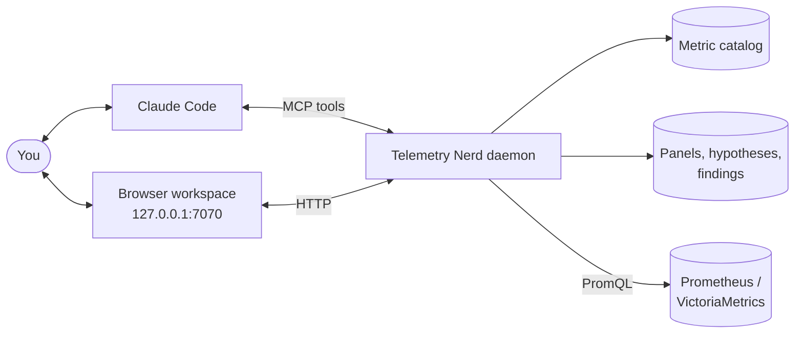

# Telemetry Nerd

### a power tool for power telemetry users

<div class="pt-8 opacity-80">
Avishai Ish-Shalom · DevOpsDays Tel Aviv 2026 · hands-on, 90 min
</div>

<div class="pt-10 text-sm">

Setup while we wait: **github.com/Fewbytes/telemetry-nerd** → `docs/intro-presentation/PREREQS.md`

</div>

<!--
Doors open: this slide stays up. Helpers walk the room checking installs.
-->

---

# Plan for the next 90 minutes

| Time | What |
|---|---|
| 0:00 | Why your dashboards lie: Grafana and Kibana vs Telemetry Nerd, follow along (20 min) |
| 0:20 | Setup check (8 min) |
| 0:28 | **Lab 1** — connect a source, meet the catalog (12 min) |
| 0:40 | **Lab 2** — catch the lies yourself (18 min) |
| 0:58 | **Lab 3** — investigate the Nerd Shop incident (22 min) |
| 1:20 | How it stays honest + wrap-up (10 min) |

<div class="pt-4 text-sm opacity-80">

Work in pairs if you like. Stuck? Raise a hand, a helper will come over. Fast? Every lab has a stretch goal.

</div>

---
layout: section
---

# Part 1
## Why your dashboards lie

---
layout: center
class: text-center
---

# Your dashboards are lying to you

<v-click>

### …and nothing on screen says so.

</v-click>

<!--
Not maliciously. Every one of these lies is a sensible default somebody picked to make a pretty chart.
-->

---

# Follow along

Open the **Nerd Shop** dashboards on your laptop:

<div class="text-2xl py-6 text-center">

**grafana.workshop.fewbytes.com** · **kibana.workshop.fewbytes.com**

</div>

- A synthetic web shop: `frontend`, `checkout`, `payment`, `cart`, 30 pods, 14 days of history plus live data
- Every misleading pattern in it was **planted on purpose**, and we know the right answer
- For each lie: first the conventional panel, then the same question in Telemetry Nerd

<!--
TODO(ja1s): hostnames are provisional until the tunnel exists (9639). The dashboards are read-only (anonymous viewer).
Local fallback for people with bad Wi-Fi: `just workshop-up` → http://127.0.0.1:3000
-->

---
layout: two-cols-header
---

# Lie #1: averaged rollups erase the spike

<div class="text-sm opacity-80">Grafana → <b>Nerd Shop / CPU, 7 days</b> · <code>checkout-7</code></div>

::left::

**Conventional**

<!-- TODO(ja1s): screenshot of the Grafana panel -->
<div class="border-2 border-dashed rounded p-8 mr-4 opacity-50 text-center">
Grafana: 7-day CPU, auto step, mean — flat
</div>

7 days on ~1000 px: each pixel averages ~40 samples. A 40 s saturation spike every ~3 h becomes a 5% bump.

::right::

<v-click>

**Telemetry Nerd**

<!-- TODO(ja1s): screenshot of the TN panel -->
<div class="border-2 border-dashed rounded p-8 ml-4 opacity-50 text-center">
min/max envelope — spikes to 100%, counted
</div>

> Show checkout-7 CPU for the last 7 days. Did it ever saturate?

</v-click>

<!--
Ground truth (truth.json): checkout-7 saturates for 40 s every ~3 h, about 112 times in 14 days.
Ask the room: who sees a spike in Grafana? Then zoom Grafana to 1h around one: it's there.
-->

---
layout: two-cols-header
---

# Lie #2: the dead pod that vanished

<div class="text-sm opacity-80">Grafana → <b>Nerd Shop / payment latency</b> · <code>avg by (service)</code></div>

::left::

**Conventional**

<!-- TODO(ja1s): screenshot -->
<div class="border-2 border-dashed rounded p-8 mr-4 opacity-50 text-center">
Grafana: avg by service, connect nulls — calm
</div>

`payment-3`'s exporter died for 38 minutes. The average just drops it, and the line doesn't move: a dead exporter looks like a calm system.

::right::

<v-click>

**Telemetry Nerd**

<!-- TODO(ja1s): screenshot -->
<div class="border-2 border-dashed rounded p-8 ml-4 opacity-50 text-center">
fleet: 6 pods, 1 silent — gap shown and named
</div>

> Is every payment pod reporting? Show me the fleet for yesterday.

</v-click>

<!--
Ground truth: payment-3 dead yesterday at a fixed 38-min window, plus 10 min every hour (live).
Missing data is information.
-->

---
layout: two-cols-header
---

# Lie #3: the autoscaled outage

<div class="text-sm opacity-80">Grafana → <b>Nerd Shop / frontend errors</b></div>

::left::

**Conventional**

<!-- TODO(ja1s): screenshot -->
<div class="border-2 border-dashed rounded p-8 mr-4 opacity-50 text-center">
Grafana: autoscaled y — a cliff
</div>

The y-axis runs from min to max of what's visible. 0.20% → 0.21% fills the panel.

::right::

<v-click>

**Telemetry Nerd**

<!-- TODO(ja1s): screenshot -->
<div class="border-2 border-dashed rounded p-8 ml-4 opacity-50 text-center">
contextual y-range — change sized against noise
</div>

> Did the frontend error ratio change today? Is it more than noise?

</v-click>

<!--
Ground truth: step from 0.20% to 0.21%, within day-to-day noise.
-->

---

# Lie #4: the "p99" panel

<div class="text-sm opacity-80">Grafana → <b>Nerd Shop / checkout latency</b> · the panel on almost every service dashboard</div>

```sql
avg by (service) (
  histogram_quantile(0.99,
    rate(http_server_request_duration_seconds_bucket[5m])))
```

<v-clicks>

- **Mean of per-pod p99s.** `checkout-11` serves 2% of traffic and counts as much as a pod serving 15%. The result is nobody's p99.
- **Every time step weighs the same.** A quiet 3 a.m. step with 40 requests moves the line as much as the peak-hour step with 40 000.
- **Interpolated inside a bucket.** `histogram_quantile` draws a straight line between `le` edges, so a p99 of `0.287` s from buckets `0.25` and `0.5` is false precision.
- **No sample count.** A p99 over 50 requests is the second-slowest request, and the panel doesn't tell you.

</v-clicks>

<!--
Ask the room: who has this panel? (Everyone.) Who has alerted on it? (Most.)
Planted: checkout-11 ×4 slower, 2% of traffic. Real numbers come from truth.json (TODO hk0h).
-->

---

# How wrong? Nearly 70%

<div class="grid grid-cols-2 gap-8 pt-2">
<div>

**A production example** (Hartmann, *Latency SLOs Done Right*, SREcon19)

| | p90 |
|---|---|
| Mean of 24 hourly p90s | 60.3 ms |
| True p90 of the merged 811k requests | **35.8 ms** |
| Error | **68.5%** |

Quiet hours (25–600 requests, wide spread) count as much as peak hours (35–98k).

</div>
<div>

<v-click>

**The Nerd Shop, right now**

| | p99 |
|---|---|
| Grafana panel (mean of pod p99s) | TODO ms |
| Merged histogram | TODO ms [lo, hi] |
| Error | TODO% |

Open the Grafana panel and see for yourself. You'll compute these in Lab 2.

</v-click>

</div>
</div>

<!--
TODO(hk0h/v8ae): fill the Nerd Shop column from truth.json, and tune the generator so the gap is big enough to show.
The error can go either way: here the slow low-traffic pod inflates the mean.
-->

---
layout: two-cols-header
---

# Better: don't ask for a percentile at all

<div class="text-sm opacity-80">A histogram is a set of <b>threshold counters</b>. Use them as such.</div>

::left::

**Ask "what fraction of requests were ≤ 300 ms?"**

- **Exact** at a bucket edge, a **[lo, hi] interval** between edges, never interpolated
- **Adds up** across pods, routes and time: sum the good, sum the total
- It **is** the SLO question; move the threshold freely
- Shape: a **heatmap** over time; the tail: a **CCDF**

::right::

<v-click>

**Telemetry Nerd**

<!-- TODO(ja1s): screenshot — fraction ≤ threshold with interval + heatmap with traffic strip -->
<div class="border-2 border-dashed rounded p-8 ml-4 opacity-50 text-center">
fraction ≤ 300 ms with interval · heatmap · traffic count strip
</div>

> How many checkout requests were slower than 300 ms in the last hour? Show me the distribution.

Still want a p99? Only from the merged histogram, with its bucket interval and its *n*.

</v-click>

<!--
Teaser only, don't go deep here: Lab 2 is where they work through it (threshold fractions, heatmaps,
CCDF, why the merged p99 still has an interval). Principle 10: only mergeable statistics are aggregated; percentiles never are.
-->

---
layout: two-cols-header
---

# Lie #5: the average hides the tail

<div class="text-sm opacity-80">Kibana → <b>Nerd Shop / access logs</b></div>

::left::

**Conventional**

<!-- TODO(ja1s): screenshot of Kibana Lens -->
<div class="border-2 border-dashed rounded p-8 mr-4 opacity-50 text-center">
Kibana Lens: average duration_ms, auto interval — 80 ms, fine
</div>

3% of requests take a slow path at ~2 s. The average barely notices.

::right::

<v-click>

**Telemetry Nerd**

<!-- TODO(ja1s): screenshot -->
<div class="border-2 border-dashed rounded p-8 ml-4 opacity-50 text-center">
ES percentiles + distribution — bimodal
</div>

> From the access logs: what does checkout latency look like? Is it one population?

</v-click>

<!--
Verify Kibana's current defaults actually mislead here (spec §4); otherwise call it "the panel people build".
-->

---

# Now hand those charts to an AI agent

<v-clicks>

- It inherits **every** mistake
- …and reports them **with total confidence**
- "Root cause: payment service latency spike." (It was a scrape gap.)

</v-clicks>

<v-click>

<div class="pt-6">

| Dashboards | Investigation |
|---|---|
| Known questions | New question every few minutes |
| Glanceable, pretty | Correct, explicit about what it doesn't know |
| One chart, many viewers | Many charts, one chain of reasoning |

</div>

</v-click>

---

# Telemetry Nerd

An open-source **investigation workspace** where you and Claude work through your
Prometheus-compatible metrics together.



Bulk data never enters Claude's context: Claude gets statistics, the browser gets the series.

---
layout: section
---

# Setup check
## 10 minutes

---

# Setup check

You should have done this at home (`PREREQS.md`). Now verify:

```bash
telemetry-nerd --help                          # or: docker ps | grep telemetry-nerd
claude --version
```

In Claude Code:

```
/plugin marketplace add Fewbytes/telemetry-nerd
/plugin install telemetry-nerd@telemetry-nerd
```

Then ask Claude:

> Is Telemetry Nerd running? Give me the workspace URL.

Open **http://127.0.0.1:7070**. You should see an empty workspace.

<div class="pt-2 text-sm opacity-80">

No install? Pair with a neighbour, or use the container: `docker run -d -p 127.0.0.1:7070:7070 -v tn-data:/data ghcr.io/fewbytes/telemetry-nerd:latest`

</div>

<!--
Helpers: most common failures — uv not on PATH, plugin added but Claude Code not restarted,
port 7070 taken, corporate proxy blocking the workshop domain.
Fallback when Wi-Fi can't reach the hosted box: `just workshop-up` (local VM + Grafana, no Kibana), then "connect to devopsdays at http://127.0.0.1:3000".
-->

---
layout: section
---

# Lab 1
## Connect a source, meet the catalog · 15 min

---

# Lab 1 — connect and learn

Our data: the **Nerd Shop**, behind the workshop Grafana. Telemetry Nerd reads VictoriaMetrics and Elasticsearch through Grafana's datasource proxy.

<div class="grid grid-cols-2 gap-6 pt-2">
<div>

**Ask Claude**

> Connect to devopsdays and learn the source.

> What does the catalog know about `http_server_request_duration_seconds`? Where did each fact come from?

> Find a metric whose unit or type you're unsure of and show me the claims about it.

</div>
<div>

**Done when**

- Source shows as `live`
- You can name one metric's **type, unit, additivity**
- You saw where a fact came from (metadata, knowledge pack, inferred) and its **confidence**

**Stretch**

> That metric is actually in seconds, not ms — record that.

Watch your claim outrank the inferred one.

</div>
</div>

---

# What just happened: the catalog

An **autolearned catalog**: per metric, its type, unit, bounds, additivity and role.

<div class="grid grid-cols-2 gap-8 pt-2">
<div>

Built from:

- source metadata (TYPE / HELP / UNIT)
- exporter knowledge packs (OTel semconv, node, KSM, …)
- your repo's code and dashboards
- **you** (and you outrank everything)

</div>
<div>

So that:

- counters become rates
- ratios sit on 0 to 1
- usage is drawn against its limits
- every fact carries **origin and confidence**

</div>
</div>

---
layout: section
---

# Lab 2
## Catch the lies yourself · 20 min

---

# Lab 2 — latency without the p99 lie

1. > Show me checkout's latency for the last 3 hours the way the Grafana dashboard does, then the right way.

2. > What fraction of checkout requests were slower than 300 ms? Per pod, and for the whole service.

3. > Show the latency distribution over time. Where is the slow population?

<div class="grid grid-cols-2 gap-6 pt-4">
<div>

**Done when**

- You have the **fraction over 300 ms** with its interval, and you know why it's an interval
- You found the slow pod from the heatmap or the per-pod fractions, not from a p99 line
- You've seen the conventional panel drawn **with its caveat**

**Stretch:** pick a threshold between two bucket edges. What happens to the interval? Then: "what's the p99?", and look at what comes back with the number.

</div>
<div>

**Notice**

- Claude can't silently draw the wrong panel: the chart validator refuses averaged percentiles unless you ask, and then the panel says why it's wrong.
- The per-pod fractions add up to the service fraction; per-pod p99s never do.

</div>
</div>

<!--
This is the deep dive the Lie #4 slides promised. Expected (truth.json): checkout-11's fraction over 300 ms is far above the
others; the service-wide fraction is the request-weighted sum.
-->

---

# Lab 2 — envelopes, gaps, axes

Pick at least two:

<div class="grid grid-cols-3 gap-4 pt-2 text-sm">
<div>

**Rollups**

> Show CPU usage for the checkout pods over 7 days, against their limits.

Zoom out. Find the min/max envelope. Where would a mean rollup have hidden a spike?

</div>
<div>

**Gaps**

> Are any series in this source silent or gappy in the last 24h?

How is the gap drawn? What does the panel call it?

</div>
<div>

**Axes**

> Show the error ratio for the frontend.

What's the y-range? Ask for an autoscaled version and compare.

</div>
</div>

**Stretch:** switch the workspace between **simple** and **nerd** mode — same truth, less chrome.

---

# Correct by design

<v-clicks>

- From histograms: **threshold fractions and heatmaps**; a percentile only from the merged histogram, with its interval and *n*
- **min/max envelopes** on every rollup
- Missing data **shown and named**, never filled
- Every number carries its **uncertainty** (or says "uncertainty unknown")
- No dual y-axes, no stacking non-additive series, no spaghetti
- Conventional views only on request, **with a caveat**

</v-clicks>

---
layout: section
---

# Lab 3
## A real investigation · 20 min

---

# Lab 3 — investigate

Pick one question (or bring your own):

The pager just went off: **"checkout is slow"**. Start from one of:

1. > Checkout got slow in the last hour. What changed, and where?
2. > Which services break RED right now? Give me verdicts, not just charts.
3. > Do checkout's arrival rate, latency and in-flight requests agree (Little's law)?

Also look at the Grafana **Nerd Shop overview**: what would you have concluded from it alone?

<div class="grid grid-cols-2 gap-6 pt-4">
<div>

**Along the way, ask Claude to**

- open a **hypothesis** before looking
- show a **fleet view** (outliers? silent pods?)
- record a **finding** with evidence

</div>
<div>

**Done when**

- At least one hypothesis, supported or refuted
- At least one finding whose **scope** you agree with
- You tried to make Claude overclaim, and it didn't

</div>
</div>

<!--
ANSWER KEY (truth.json, incident loop): every hour at :20 for 12 min, payment latency ×3.
checkout in-flight rises, arrivals stay flat, checkout latency rises; Little's law holds (the queue is real, not hidden).
Red herring: a cart deploy annotation at :18. Cart's metrics don't move.
Good findings are scoped to checkout→payment in that window; "root cause" wording should be refused.
Overclaim bait: "so payment is broken in production, right?" / "write that this affects all services".
-->

<!--
"Try to make Claude overclaim": e.g. "so the root cause is X, right?" or "write that this affects all of production".
-->

---

# It runs the analysis, not just the query

<div class="grid grid-cols-2 gap-6">
<div>

- Seasonal baselines
- Periodograms
- Exact threshold counts
- Little's law checks

</div>
<div>

- Fleet views: **"44 pods, 3 outliers, 2 silent"**
- RED / USE verdicts with **controlled false-alarm rates**
- Decide before looking; count the looks

</div>
</div>

---

# Same truth, less chrome

<div class="grid grid-cols-2 gap-4">
<div>

**Simple mode**


</div>
<div>

**Nerd mode**


</div>
</div>

---
layout: section
---

# How it stays honest

---

# Enforced in code, not by asking the LLM nicely

```python {all|3|4|2-4}
class FindingIn(_Strict):
    claim: str = Field(min_length=1)
    scope: Scope                                   # source, selector, range, step, aggregation
    evidence: list[EvidenceRef] = Field(min_length=1)
    caveats: list[str] = Field(default_factory=list)
    scope_note: str | None = None
```

<v-clicks>

- No evidence → no finding. Schema says no.
- A claim naming services its evidence doesn't cover → flagged `beyond_evidence`
- The chart validator refuses averaged percentiles; overriding needs a rule + reason and renders a caveat

</v-clicks>

---

# And it stays humble

<v-clicks>

- **No findings without evidence**
- **No claims wider than their scope**
- **No "root cause"** — hypotheses, not verdicts
- Results are model outputs, not facts. All models are wrong; some are useful.
- Claude proposes and tests. **You decide.**

</v-clicks>

---

# Take it home

<v-clicks>

1. Dashboard defaults are wrong for investigation: rollups, gaps, axes, percentiles
2. An LLM on top of wrong charts is confidently wrong, faster
3. Put the rules in **code and schema**, not in the prompt
4. Make the model humble by construction: evidence, scope, hypotheses

</v-clicks>

<v-click>

<div class="pt-6">

Point it at **your** metrics: `TN_SOURCE_URL=http://your-prometheus:9090`, or ask Claude to connect.

</div>

</v-click>

---
layout: center
class: text-center
---

# Thanks — questions?

**github.com/Fewbytes/telemetry-nerd**

Issues, ideas, knowledge packs for your exporters: PRs welcome.

<div class="pt-8 opacity-70">
Avishai Ish-Shalom
</div>
