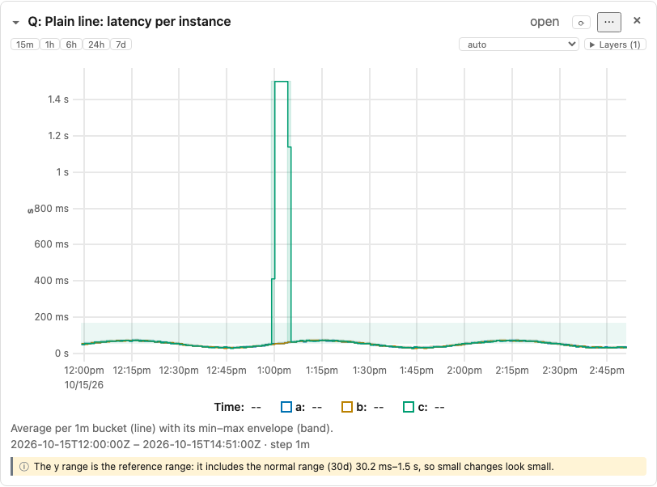
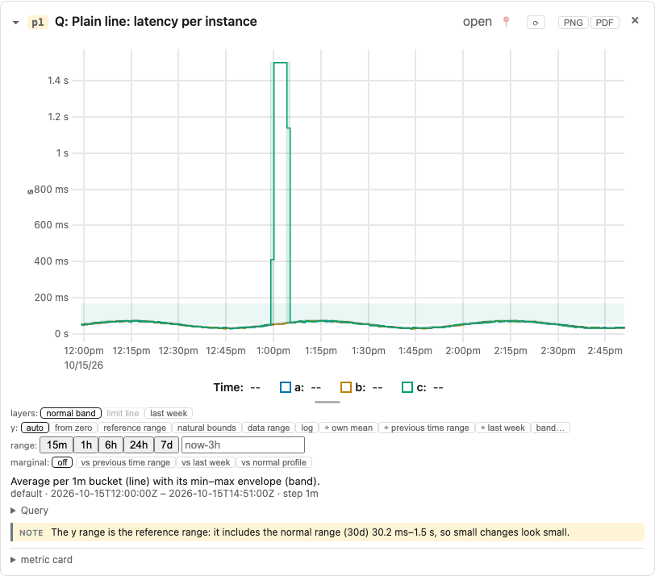

# Simple and nerd modes

Telemetry Nerd shows panels in one of two display modes. Both show the same truth
([principle 18](principles.md#18-same-truth-less-chrome)); they differ in how much chrome
surrounds it.

- **Simple** (the default): the question, the plot, coverage rugs, annotations, views, legend and
  notes, plus a compact toolbar. Closer to a traditional graphing tool.
- **Nerd**: everything: all controls, the "Shown" block with the query, the metric card, the
  marginal histogram.

| Simple | Nerd |
|---|---|
|  |  |

## Switching

- **Header toggle** (`simple` / `nerd`): overrides the mode for the current browser session.
- **Settings > Default mode**: the mode a new session starts in; stored in this browser
  (`localStorage`). Changing it clears the session override.
- **Per panel**: in simple mode, the panel's `⋯` menu has **Show nerd view**, which renders that
  one panel in full until you press **Simple view**. The global mode is unchanged and the peek is
  not remembered across reloads.

The Catalog and Proposals views look the same in both modes, and PDF export is always the full
(nerd) rendering. The Sidebar and the highlight strip get a slim form in simple mode.

## What simple mode hides and keeps (time panel)

| Part | Simple mode |
|---|---|
| Header: collapse, question, status, loading, refresh, close | Kept |
| Header: object id, pin | Hidden |
| Header: PNG / PDF export | In the `⋯` menu |
| Plot: series, bands, coverage rug, annotations, crosshair, linked brush | Kept |
| Plot: `y ≠ 0` badge | Kept (it changes the reading) |
| Plot: marginal histogram, resize handle | Hidden |
| Controls | A compact toolbar above the plot: time-range presets (15m, 1h, 6h, 24h, 7d) on the left; y-view, reference layers and series filter dropdowns on the right. Reframe, follow-up and the marginal reference picker are hidden. Disabled controls keep their explanation on hover |
| Legend | Kept, with short series labels |
| "Shown" block and Query | Hidden; one line `range · step` |
| Notes and caveats | Kept, compact: an icon and short text, the full text on hover or focus, the highlight on the graph preserved |
| Metric card | Hidden |
| Threads | One-line summary, expandable |

Simple mode never removes a caveat that changes how you read the chart: bands, rugs, scoped-claim
notes, the preview badge and the `y ≠ 0` badge stay. Hover a collapsed note for its full text, or
use **Show nerd view**.

## Other panel kinds in simple mode

| Kind | Simple mode |
|---|---|
| Heatmap | View and colour switches and the colour key stay; colormap and outline pickers go |
| Histogram / ECDF | View and bar-mode switches stay; the drag hint goes; the aggregation note is one line |
| SPC | The supplementary run-rules checkbox goes; the legend is one line |
| Fleet | View switch, encoding and key stay; the summary is one line |
| Little's law | The verdict / raw switch stays; the legend is one line |
| Seasonal | The cycles / ratio switch and the reasons stay; the legend is one line |
| Spectrum, spectrogram | The legend is one line; the "what" sentence stays in full |
| Binding group | Id, kind, key and metrics stay; the binding line and per-role details are one line |

One-line text opens in place on click, with the full text in its tooltip.

Vocabulary: [glossary](glossary.md). Design: `docs/superpowers/specs/2026-10-14-simple-nerd-modes-design.md`.
